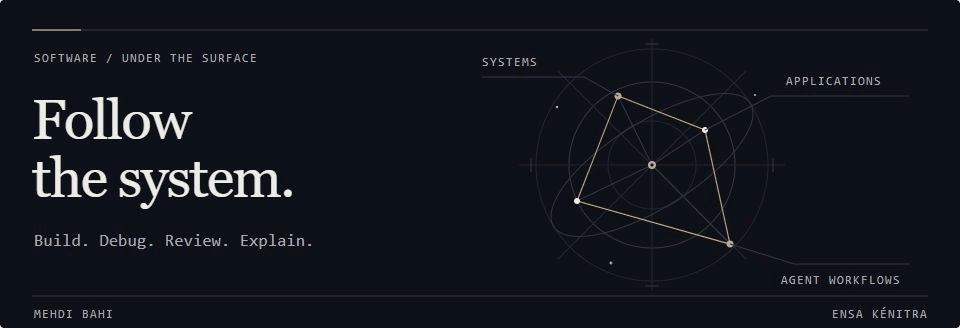

# Hi, I'm Mehdi Bahi

**Software Engineering Student @ ENSA Kénitra**

[Email](mailto:mr.mehdi.bahi@gmail.com) · [LinkedIn](https://www.linkedin.com/in/bahimehdi) · [GitHub](https://github.com/bahimehdi)

 

I build full-stack applications, work with Unix systems and databases, and explore agentic development. I care about understanding what I build well enough to debug it, review it, and explain it.

## Skills & technologies

### Programming languages

           

### Application development

         

### Databases

      

### Systems & tools

         

### Data & BI

     

### Modeling & extension development

  

**Also worked with:** Unix processes, pipes and signals; TCP/UDP sockets; Cisco routing and switching; REST APIs, OpenAPI, JWT and OAuth2; relational modeling and Entity Framework Core.

## Selected project

### LazyDeals

I built LazyDeals to help PC players track game prices. It combines a shared watchlist with multi-store and regional Steam pricing, Steam wishlist import, budget bundles, and reported 100%-off offers. Background checks notify users when a saved price target is met.

[Website](https://lazydeals.tech/) · [Chrome Web Store](https://chromewebstore.google.com/detail/lazydeals/dlcikhpiigmpciddcdjclepnppcachni) · [Microsoft Edge Add-ons](https://microsoftedge.microsoft.com/addons/detail/lazydeals/hldbfjjaedkheeglkflhnkkppgeiihhm)

## Agentic development

**Codex · Claude Code · OpenCode**

Repository rules, reusable skills, and agent harnesses. Planning, implementation, review, and verification around real software projects.

## GitHub activity

